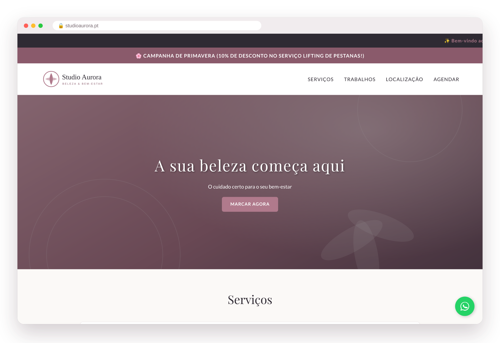
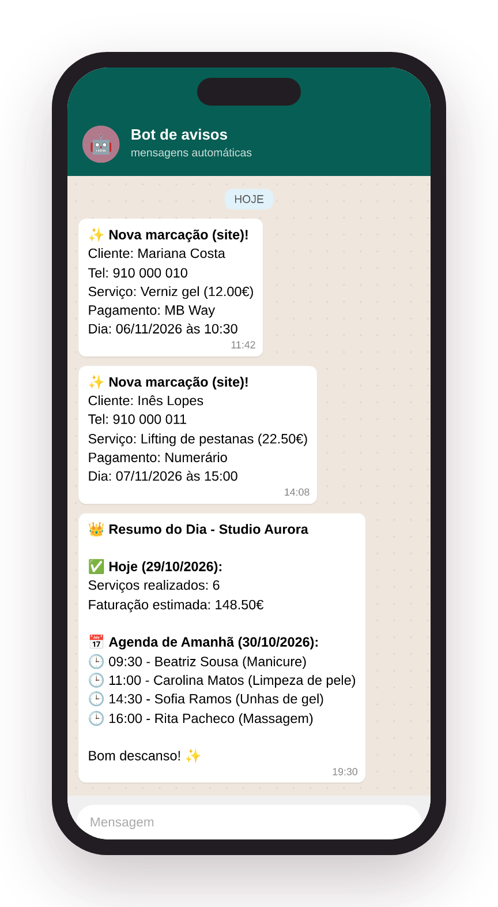
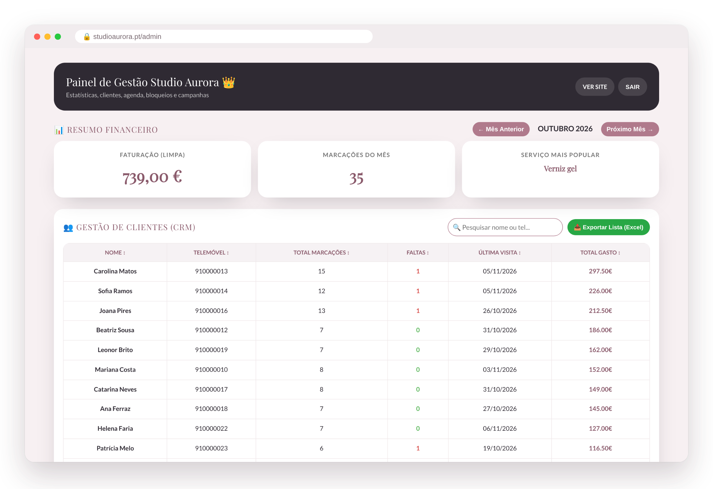

# Template Studio — site de marcações para salões

Site público + agenda online + painel de gestão + avisos por WhatsApp, para salões de beleza e estéticas.
Cada loja é configurada num só ficheiro: [`public/loja.js`](public/loja.js).

 

*Imagens da loja de demonstração "Studio Aurora" (dados fictícios).*

- **Site:** design moderno e animado, próxima vaga em tempo real, serviços em cartões por categoria, marcação em 3 passos (serviço → dia → hora), galeria com zoom, avaliações do Google, PWA.
- **Painel:** faturação, gráficos, clientes (CRM), agenda semanal, marcações manuais com repetição, vouchers, preços, bloqueios, notícias.
- **Equipa (opcional):** escolher a profissional com foto, agenda e horário por pessoa, login próprio para cada colaboradora (só vê a sua agenda), números por colaboradora. Exemplo em `exemplos/loja-equipa.js`.
- **WhatsApp:** aviso a cada nova marcação e resumo diário (Cloud Functions + CallMeBot).
- **Segurança:** login Firebase Auth, dados das clientes privados, agenda pública só com horas ocupadas.

Instruções completas em [LEIA-ME.md](LEIA-ME.md).
